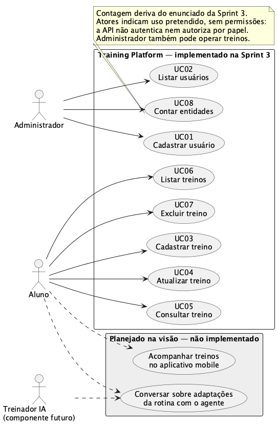

# Casos de uso: gerenciamento de usuários

O diagrama da Entrega 1 apresenta os dois tipos de usuário cadastrados, Aluno e Administrador, e os casos de uso de cadastro e listagem. Ele retrata o acesso possível na API atual, que não autentica nem autoriza operações por papel. A intenção mais recente do grupo é que o administrador realize cadastro e listagem; essa restrição ainda não está implementada e deve ser refletida em um diagrama futuro quando o controle de acesso for definido.

Fonte editável: [PlantUML](../diagramas/casos-de-uso-usuarios.puml). Os requisitos observáveis estão em [Gerenciamento de usuários](../../openspec/specs/usuarios/spec.md).
