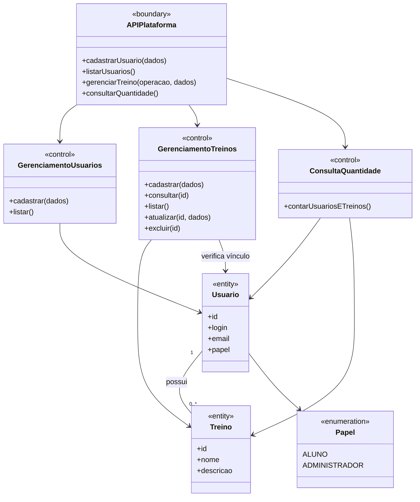

# Classes de análise: usuários e treinos

A análise representa conceitos do problema e responsabilidades de fronteira,
controle e entidade. Não descreve classes concretas de persistência nem os
mecanismos do Singleton; estes ficam no [projeto](08-projeto.md).

Treino é um plano, ainda sem exercícios ou execução. Cada treino pertence a
exatamente um usuário existente; um usuário pode não ter treinos. O papel não
impõe autorização no protótipo. Aplicativo e treinador IA permanecem futuros.
