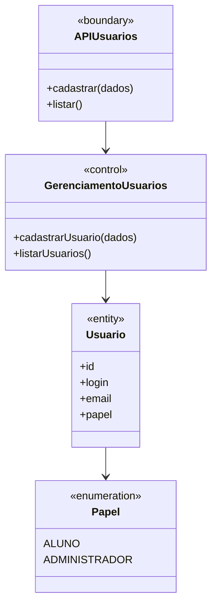

# Classes de análise: gerenciamento de usuários

Na visão de análise, a fronteira recebe pedidos de cadastro e listagem; o controle aplica as regras; a entidade representa o usuário cadastrado. Os dois papéis previstos são Aluno e Administrador. O treinador IA será um componente futuro, sem papel de usuário nesta entrega.

As classes de implementação, exceções e alternativas de persistência aparecem no [diagrama de projeto](08-projeto.md).
