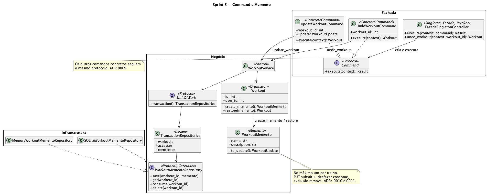
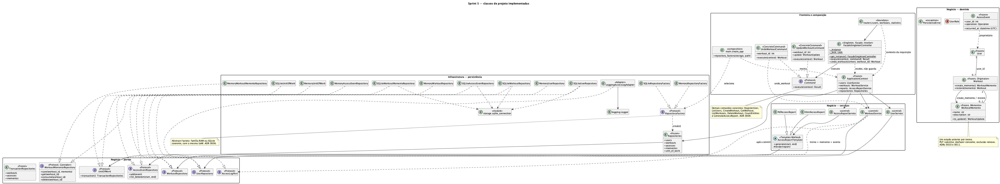
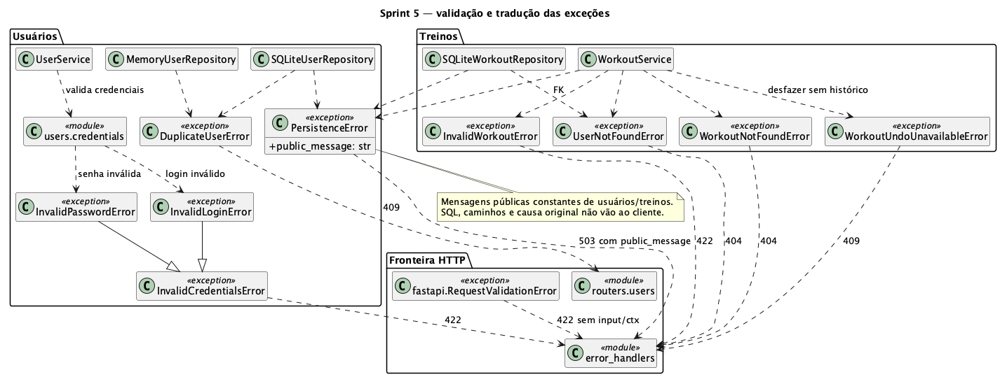

# Projeto: usuários, treinos, eventos, Command e Memento

## Pacotes e responsabilidades

| Módulo | Responsabilidade |
| --- | --- |
| `app/main.py` | Resolver armazenamento, criar a família de repositórios via fábrica e compor `ApplicationContext`. |
| `app/repositories.py` | Abstract Factory (`RepositoryFactory`), agregado `Repositories` e unidades de trabalho RAM/SQLite. |
| `app/commands.py` | Comandos imutáveis da fachada. Cada um guarda só os argumentos e delega ao serviço do contexto recebido em `execute`. |
| `app/accesses/domain.py` | Entidade `AccessEvent`, normalização UTC e intervalo semiaberto. |
| `app/accesses/ports.py`, `app/users/ports.py`, `app/workouts/ports.py` | Protocolos consumidos pelos serviços (camada de negócio). |
| `app/accesses/repository.py`, `app/users/repository.py`, `app/workouts/repository.py` | Implementações RAM/SQLite; módulos antigos reexportam os protocolos. |
| `app/dependencies.py` | Obter o contexto da aplicação que recebeu a requisição. |
| `app/routers/`, `app/schemas.py`, `app/workouts/schemas.py` | Validar o contrato HTTP e publicar somente os campos públicos. |
| `app/unit_of_work.py` | Contrato de negócio para escrita coordenada de treino, Memento e evento. |
| `app/facade.py` | Fachada única por processo. Cada método cria um comando e chama `execute` com o contexto da requisição; não guarda dados. |
| `app/users/service.py`, `app/users/credentials.py` | Regras de usuários, normalização e hash. |
| `app/workouts/service.py`, `app/workouts/policy.py` | Regras e limites de treinos. No `PUT`, captura o Memento; no desfazer, consome e restaura. Evento e log após commit. |
| `app/workouts/domain.py` | `Workout` cria e restaura `WorkoutMemento`. `WorkoutUndoUnavailableError` sinaliza ausência de histórico. |
| `app/accesses/logging_adapter.py` | `LoggingAccessLogAdapter` adapta `AccessLogPort` ao `logging.Logger` da biblioteca padrão. |
| `app/reports/domain.py`, `app/reports/template.py`, `app/reports/service.py` | Contratos imutáveis, agregação, Template Method e seleção de formato na camada de negócio. |
| `app/reports/renderers.py`, `app/reports/schemas.py` | Renderização HTML/ReportLab PDF e validação RFC 3339 na fronteira HTTP. |
| `app/users/factory.py` | Resolver `USER_STORAGE` / `USER_DATABASE`; preservar `create_user_repository` para testes legados. |
| `app/storage.py` | Abrir/fechar conexões SQLite, ativar FK e delimitar transações. |
| `app/error_handlers.py` | Traduzir validação (422), ausência (404), desfazer sem histórico (409) e indisponibilidade (503) sem expor dados internos. |

## Diagrama de classes de projeto

### Command e Memento

[Fonte PlantUML](diagramas/command-memento.puml). A fachada é o invocador.
`UndoWorkoutCommand` e `UpdateWorkoutCommand` delegam ao serviço de treinos.
`Workout` cria e restaura o Memento; a unidade de trabalho entrega o
repositório que guarda um único estado anterior, em RAM ou SQLite.

### Mapa das camadas

[Fonte PlantUML](diagramas/classes-analise-usuarios.puml). O nome histórico do
arquivo foi preservado. Command e Memento estão implementados conforme a tabela
abaixo e os [ADRs 0009](adr/0009-fachada-command.md),
[0010](adr/0010-persistencia-memento.md) e
[0011](adr/0011-contrato-desfazer-treino.md). Adapter e Template Method
permanecem nos [ADRs 0007](adr/0007-adapter-log-eventos.md) e
[0008](adr/0008-relatorio-template-method.md). Os contratos de treinos e fachada
da Sprint 3 permanecem nos [ADRs 0005](adr/0005-treinos-fachada.md) e
[0006](adr/0006-repository-factory.md).

### Validação e tratamento de exceções

[Fonte PlantUML](diagramas/excecoes-validacao.puml). Esta visão complementar
representa as exceções de validação de usuários e treinos. O relatório responde 503
na geração e 422 no período inválido. `WorkoutService` sinaliza a primeira regra inválida;
erros de ausência são 404, desfazer sem histórico é 409
(`Nenhuma atualização disponível para desfazer`), indisponibilidade é 503 e
duplicidade de usuário continua 409.

## Padrões implementados

| Padrão | Participantes reais | Como verificar |
| --- | --- | --- |
| Singleton | `FacadeSingletonController`, `_instance`, `_lock`, `__new__`, `get_instance` | Construtor e accessor retornam a mesma instância no processo. |
| Facade | Rotas como clientes; `FacadeSingletonController` cria o comando e chama `execute`; os serviços do contexto são os recebedores | Operações de usuários, treinos, desfazer, contagem e relatório passam pela fachada; `tests/test_facade.py` e `tests/test_commands.py`. |
| Command | Client: rotas e métodos da fachada. Command: protocolo `Command`. ConcreteCommand: `RegisterUserCommand`, `ListUsersCommand`, `CreateWorkoutCommand`, `GetWorkoutCommand`, `ListWorkoutsCommand`, `UpdateWorkoutCommand`, `UndoWorkoutCommand`, `DeleteWorkoutCommand`, `CountEntitiesCommand`, `GenerateAccessReportCommand`. Invoker: `FacadeSingletonController.execute`. Receiver: serviços do `ApplicationContext` | `tests/test_commands.py`: delegação, imutabilidade, erro propagado e isolamento de contexto. Contratos HTTP anteriores preservados. |
| Memento | Originator: `Workout.create_memento` e `Workout.restore`. Memento: `WorkoutMemento`. Caretaker: `WorkoutMementoRepository` (`save`, `get`, `consume`, `delete`) em RAM e SQLite, exposto pela unidade de trabalho | `tests/test_workout_memento_persistence.py` e `tests/test_workout_undo.py`: um estado por treino, consumo único, bancos legados, rollback e concorrência. |
| Repository | `UserRepository`, `WorkoutRepository`, `WorkoutMementoRepository`, `AccessEventRepository` em `ports`; implementações em `repository.py` | Serviços dependem de protocolos; `tests/test_access_repositories.py`, `tests/test_workout_memento_persistence.py` e contratos de treinos/usuários. |
| Abstract Factory | `repository_factory`, `RepositoryFactory`, `MemoryRepositoryFactory`, `SQLiteRepositoryFactory`, `Repositories` | `create_app` seleciona família RAM ou SQLite, incluindo o repositório de Memento; `tests/test_facade.py` cobre configuração. |
| Unit of Work | `UnitOfWork`, `TransactionRepositories` (`workouts`, `accesses`, `mementos`), `MemoryUnitOfWork`, `SQLiteUnitOfWork` | Escrita coordenada de treino, Memento e evento; `BEGIN IMMEDIATE` no SQLite. Testes de commit, rollback e concorrência. |
| Adapter | `WorkoutService` (cliente), `AccessLogPort` (Target), `LoggingAccessLogAdapter` (Adapter), `logging.Logger` (Adaptee) | `test_access_recording.py`: log real após commit e substituto com falha; somente proprietário, operação e instante UTC. |
| Template Method | `AccessReportTemplate.generate` (algoritmo), `render` (passo abstrato), `HtmlAccessReport` e `PdfAccessReport` (subclasses) | `test_access_reports.py`: fluxo único, equivalência HTML/PDF, filtros, período vazio, falhas e paginação. |

`ApplicationContext` mantém serviços e o agregado `Repositories` de uma aplicação.
A fachada não guarda contexto nem histórico. `count_entities` soma usuários e
treinos apenas; eventos e Mementos não entram na contagem. Duas aplicações RAM
isolam eventos e estados anteriores; o mesmo arquivo SQLite compartilha o que
foi confirmado.

Cada treino tem no máximo um `WorkoutMemento`, com o nome e a descrição
anteriores ao último `PUT` bem-sucedido. O desfazer consome esse estado uma
vez. Criar treino não cria Memento; excluir o treino apaga o Memento. O comando
não armazena o estado anterior.

Os [ADRs 0003](adr/0003-validacao-persistencia.md)–[0004](adr/0004-revisao-entrega-1.md)
registram entregas anteriores; o [0006](adr/0006-repository-factory.md) registra
Factory e repositório de eventos. O [0007](adr/0007-adapter-log-eventos.md) registra
o Adapter; o [0008](adr/0008-relatorio-template-method.md) registra Template Method.
O [0009](adr/0009-fachada-command.md) registra Command; o
[0010](adr/0010-persistencia-memento.md) registra a persistência do Memento; o
[0011](adr/0011-contrato-desfazer-treino.md) registra o contrato HTTP de desfazer.
Fechamento da sprint anterior: [docs/sprint4/README.md](sprint4/README.md).
Fechamento desta sprint: [docs/sprint5/README.md](sprint5/README.md).
