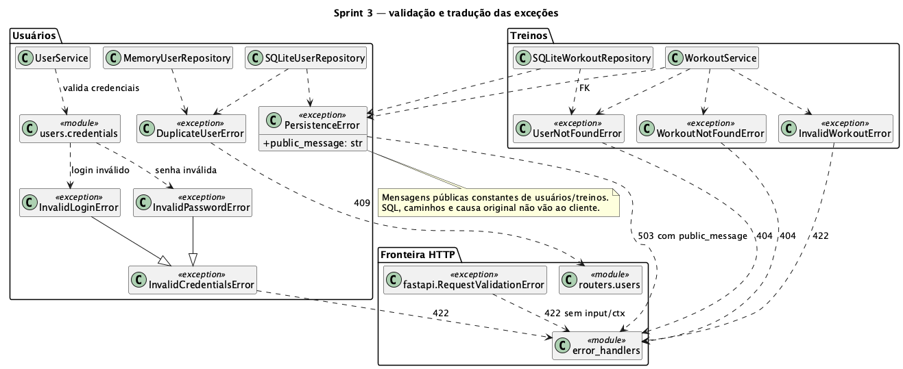

# Projeto: usuários, treinos e fachada

## Pacotes e responsabilidades

| Módulo | Responsabilidade |
| --- | --- |
| `app/main.py` | Compor uma aplicação e seus dois repositórios com a mesma configuração. |
| `app/dependencies.py` | Obter o contexto da aplicação que recebeu a requisição. |
| `app/routers/`, `app/schemas.py`, `app/workouts/schemas.py` | Validar o contrato HTTP e publicar somente os campos públicos. |
| `app/facade.py` | Reunir operações em uma fachada única por processo, delegando aos serviços do contexto. |
| `app/users/service.py`, `app/users/credentials.py` | Regras de usuários, normalização e hash. |
| `app/workouts/service.py`, `app/workouts/policy.py` | Regras e limites de treinos, existência do vínculo e erros de negócio. |
| `app/users/domain.py`, `app/workouts/domain.py` | Entidades, DTOs congelados e exceções de domínio. |
| `app/users/repository.py`, `app/workouts/repository.py` | Protocolos e implementações RAM/SQLite. |
| `app/users/factory.py` | Resolver seleção de armazenamento; preservar a fábrica pública de usuários. |
| `app/storage.py` | Abrir/fechar conexões SQLite, ativar FK e delimitar transações. |
| `app/error_handlers.py` | Traduzir validação, ausência e indisponibilidade sem expor dados internos. |

## Diagrama de classes de projeto

[Fonte PlantUML](diagramas/classes-analise-usuarios.puml). O nome histórico do
arquivo foi preservado; o conteúdo representa as classes atuais. Os DTOs têm
seus atributos omitidos nesta visão para manter a leitura. Os contratos completos ficam no
[ADR 0005](adr/0005-treinos-fachada.md) e nas especificações de
[treinos](../openspec/specs/treinos/spec.md) e
[fachada](../openspec/specs/fachada/spec.md).

### Validação e tratamento de exceções

[Fonte PlantUML](diagramas/excecoes-validacao.puml). Esta visão complementar
preserva a hierarquia `InvalidCredentialsError` → `InvalidLoginError` /
`InvalidPasswordError` da Sprint 2 e apresenta as exceções da Sprint 3.
`WorkoutService` sinaliza a primeira regra inválida; erros de ausência são 404,
indisponibilidade é 503 e duplicidade de usuário continua 409. As setas à
fronteira representam a tradução de exceções, não imports HTTP no domínio.

## Padrões implementados

| Padrão | Participantes reais | Como verificar |
| --- | --- | --- |
| Singleton | `FacadeSingletonController`, `_instance`, `_lock`, `__new__`, `get_instance` | Construtor e accessor retornam a mesma instância, inclusive na primeira criação concorrente em processo novo. |
| Facade | Rotas como clientes, `FacadeSingletonController` como fachada, `UserService` e `WorkoutService` como subsistemas | Todas as oito operações passam pela fachada; substitutos nos testes observam a chamada e o contexto. |
| Contratos de persistência | `UserRepository`, `WorkoutRepository`, respectivas implementações RAM/SQLite | Serviços recebem protocolos; os testes também usam implementações independentes. |

`ApplicationContext` mantém referências imutáveis aos serviços de uma aplicação.
A fachada não guarda esse contexto. `count_entities(context) -> int` soma
usuários (dos dois papéis) e treinos a partir dos repositórios; não há contador
global. Duas aplicações RAM são independentes; o mesmo arquivo SQLite é
compartilhado intencionalmente. A contagem não promete uma fotografia
transacional única durante mutações concorrentes nas duas coleções.

Os [ADRs 0003](adr/0003-validacao-persistencia.md) e
[0004](adr/0004-revisao-entrega-1.md) documentam as decisões anteriores.
Adapter, Template Method, Command e Memento permanecem fora desta sprint.
