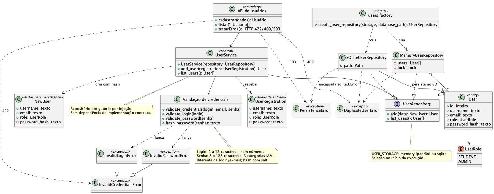

# Projeto: gerenciamento de usuários

## 1. Pacotes e responsabilidades

`app/routers/` e `app/schemas.py` compõem a fronteira HTTP. `app/users/service.py` coordena validação, hash, cadastro e listagem; `app/users/domain.py` contém a entidade e as exceções; `app/users/repository.py` oferece o contrato de persistência e as implementações RAM e SQLite. A estrutura atual está detalhada em [arquitetura](arquitetura.md).

## 2. Diagrama de classes de projeto

O diagrama mostra o tratamento de erros e os dois mecanismos de persistência pedidos na Sprint 2.

Fonte editável: [PlantUML](diagramas/classes-analise-usuarios.puml). A escolha de persistência e o tratamento das falhas estão registrados no [ADR 0003](adr/0003-validacao-persistencia.md).

## 3. Padrões e evolução

| Elemento atual | Papel no projeto | Situação |
| --- | --- | --- |
| `UserRepository` | Contrato para armazenamento de usuários. | Implementado com RAM e SQLite. |
| `UserService` | Coordena regras de negócio de usuários. | Implementado para o núcleo da Entrega 1. |

A introdução de padrões pedidos nas sprints seguintes será documentada quando cada mudança for proposta e implementada.
