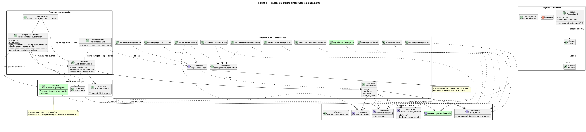
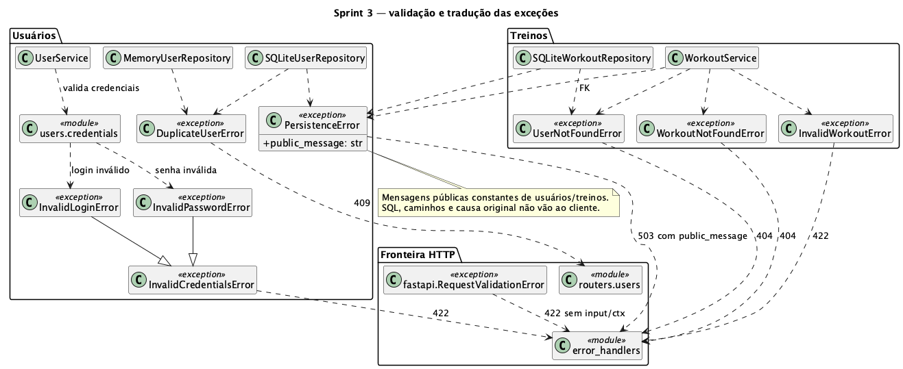

# Projeto: usuários, treinos, eventos e fachada

## Pacotes e responsabilidades

| Módulo | Responsabilidade |
| --- | --- |
| `app/main.py` | Resolver armazenamento, criar a família de repositórios via fábrica e compor `ApplicationContext`. |
| `app/repositories.py` | Abstract Factory (`RepositoryFactory`), agregado `Repositories` e unidades de trabalho RAM/SQLite. |
| `app/unit_of_work.py` | Contrato de negócio para escrita coordenada de treino e evento. |
| `app/accesses/domain.py` | Entidade `AccessEvent`, normalização UTC e intervalo semiaberto. |
| `app/accesses/ports.py`, `app/users/ports.py`, `app/workouts/ports.py` | Protocolos consumidos pelos serviços (camada de negócio). |
| `app/accesses/repository.py`, `app/users/repository.py`, `app/workouts/repository.py` | Implementações RAM/SQLite; módulos antigos reexportam os protocolos. |
| `app/dependencies.py` | Obter o contexto da aplicação que recebeu a requisição. |
| `app/routers/`, `app/schemas.py`, `app/workouts/schemas.py` | Validar o contrato HTTP e publicar somente os campos públicos. |
| `app/facade.py` | Reunir operações em uma fachada única por processo, delegando aos serviços do contexto. |
| `app/users/service.py`, `app/users/credentials.py` | Regras de usuários, normalização e hash. |
| `app/workouts/service.py`, `app/workouts/policy.py` | Regras e limites de treinos; **registro de eventos e relatório** entram nos PRs de Luigi e Miguel. |
| `app/users/factory.py` | Resolver `USER_STORAGE` / `USER_DATABASE`; preservar `create_user_repository` para testes legados. |
| `app/storage.py` | Abrir/fechar conexões SQLite, ativar FK e delimitar transações. |
| `app/error_handlers.py` | Traduzir validação, ausência e indisponibilidade sem expor dados internos. |

## Diagrama de classes de projeto

[Fonte PlantUML](diagramas/classes-analise-usuarios.puml). O nome histórico do
arquivo foi preservado. Participantes em cinza (`#TECHNOLOGY`) são contratos
previstos na change [relatorio-de-acessos](../openspec/changes/relatorio-de-acessos/proposal.md)
e ainda não presentes no código. Os contratos de treinos e fachada da Sprint 3
permanecem nos [ADRs 0005](adr/0005-treinos-fachada.md) e [0006](adr/0006-repository-factory.md).

### Validação e tratamento de exceções

[Fonte PlantUML](diagramas/excecoes-validacao.puml). Esta visão complementar
permanece da Sprint 3 até revisão conjunta com os novos fluxos de relatório (503
na geração, 422 no período). `WorkoutService` sinaliza a primeira regra inválida;
erros de ausência são 404, indisponibilidade é 503 e duplicidade de usuário
continua 409.

## Padrões implementados

| Padrão | Participantes reais | Como verificar |
| --- | --- | --- |
| Singleton | `FacadeSingletonController`, `_instance`, `_lock`, `__new__`, `get_instance` | Construtor e accessor retornam a mesma instância no processo. |
| Facade | Rotas como clientes, `FacadeSingletonController`, `UserService` e `WorkoutService` | Operações atuais passam pela fachada; testes usam substitutos. |
| Repository | `UserRepository`, `WorkoutRepository`, `AccessEventRepository` em `ports`; implementações em `repository.py` | Serviços dependem de protocolos; `tests/test_access_repositories.py` e contratos de treinos/usuários. |
| Abstract Factory | `repository_factory`, `RepositoryFactory`, `MemoryRepositoryFactory`, `SQLiteRepositoryFactory`, `Repositories` | `create_app` seleciona família RAM ou SQLite; `tests/test_facade.py` cobre configuração. |
| Unit of Work | `UnitOfWork`, `TransactionRepositories`, `MemoryUnitOfWork`, `SQLiteUnitOfWork` | Escrita coordenada treino + evento em um bloco; testes de commit e rollback em `test_access_repositories.py`. |
| Adapter | *Planejado* — porta de log sem dados sensíveis | ADR e implementação no PR de Luigi (`tasks.md` 2.2). |
| Template Method | *Planejado* — agregação + renderização HTML/PDF | ADR/contrato público no PR de Miguel (`tasks.md` 3.x). |

`ApplicationContext` mantém serviços e o agregado `Repositories` de uma aplicação.
A fachada não guarda contexto. `count_entities` soma usuários e treinos apenas;
eventos não entram na contagem (RF da change). Duas aplicações RAM isolam eventos;
o mesmo arquivo SQLite compartilha eventos confirmados.

Os [ADRs 0003](adr/0003-validacao-persistencia.md)–[0004](adr/0004-revisao-entrega-1.md)
registram entregas anteriores; o [0006](adr/0006-repository-factory.md) registra
Factory e repositório de eventos. Esboços [0007](adr/0007-adapter-log-eventos.md) e
[0008](adr/0008-relatorio-template-method.md) completam nos PRs de Luigi e Miguel.
Handoff: [docs/sprint4/README.md](sprint4/README.md). Command e Memento continuam fora do escopo.
