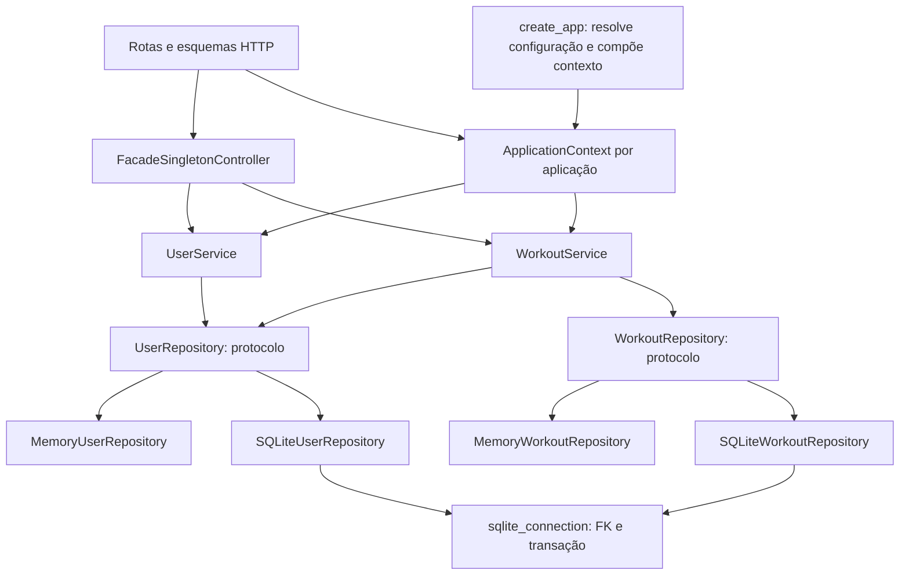
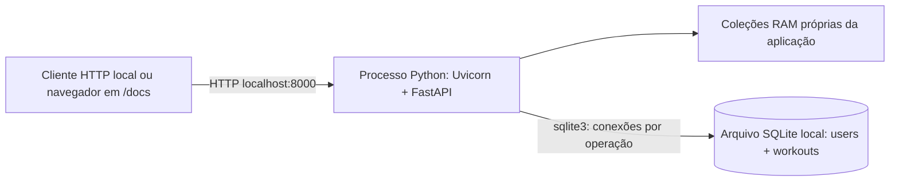
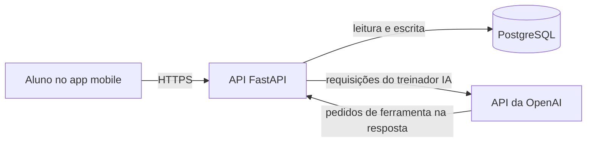

# Arquitetura do projeto

## Estado atual — Sprint 3

API local Python 3.12/FastAPI/Pydantic. Usuários e planos de treino são
executáveis; aplicativo mobile, PostgreSQL, ORM e treinador IA são futuros.
O [ADR 0005](adr/0005-treinos-fachada.md) registra a fachada, os novos contratos
e o isolamento. Os [ADRs anteriores](adr/) permanecem como histórico.

### Arquitetura lógica



As setas de protocolo para implementação indicam alternativas de composição;
serviços não importam classes concretas. A fachada delega ao contexto recebido,
sem armazená-lo. SQL e coleções pertencem aos repositórios. Os tratadores da
fronteira traduzem exceções sem publicar causas, caminhos ou entrada sensível.

### Arquitetura física atual



RAM e SQLite são alternativas escolhidas na inicialização. USER_STORAGE aceita
memory (padrão) ou sqlite; USER_DATABASE indica o arquivo. Argumentos explícitos
de create_app têm precedência sobre o ambiente. O diretório precisa existir.
Não há servidor de banco nem serviço externo necessário. RAM é volátil; SQLite
reabre tabelas existentes sem apagar registros. Mesmo arquivo compartilha dados
entre aplicações/processos; a fachada permanece única apenas dentro do processo.
A contagem consulta duas coleções em sequência, sem fotografia transacional
entre elas sob concorrência.

### RNFs e decisões verificáveis

| RNF | Decisão | Evidência |
| --- | --- | --- |
| NF-SEG-01, NF-SEG-02 | Resposta pública de usuários sem credenciais; hash com salt. ADRs 0003/0004. | Testes de usuários, credenciais e hash; comparação de respostas. |
| NF-SEG-03 | Resposta de treino só com quatro campos; erros sem input/ctx. ADR 0005. | Tipos inválidos/extras sensíveis, senha usada como texto legítimo e DELETE vazio. |
| NF-CON-01, NF-CON-04 | Erros de banco preservados como causa, mensagens públicas constantes. ADRs 0003/0005. | Tabelas removidas, todas as rotas 503, busca de vínculo e contagem em cada repositório. |
| NF-CON-02, NF-CON-05 | Transações SQLite por escrita. ADRs 0003/0005. | Gatilhos AFTER INSERT/UPDATE/DELETE abortam; estado integral preservado e recuperação. |
| NF-CON-03, NF-CON-06 | CREATE IF NOT EXISTS e arquivo persistido; AUTOINCREMENT em treinos. ADR 0005. | Banco legado, reinício com campos/exclusão/contagem e continuação dos IDs. |
| NF-MAN-01, NF-MAN-02 | Serviços injetados por protocolos e DTOs. ADRs 0004/0005. | Contratos substitutos independentes, sem SQL/HTTP no serviço. |
| NF-USA-01, NF-USA-02 | Validação de campos e exceções específicas antes da escrita. ADRs 0004/0005. | Limites, normalização, tipos e prioridade das regras no domínio. |

As especificações normativas estão em [RNFs](../openspec/specs/rnf/); o
[projeto](08-projeto.md) detalha os participantes de Singleton e Facade.

## Stack planejada

| Parte | Tecnologias | Papel |
| --- | --- | --- |
| API | Python 3.12 e FastAPI | Expor operações de usuários e treinos, validar acesso e coordenar o agente. |
| Persistência | PostgreSQL e, como ORM proposta, SQLAlchemy 2 | Guardar usuários, treinos, exercícios e histórico em uma possível evolução posterior do SQLite atual. |
| Mobile | React Native com Expo | Interface do aluno para solicitar, visualizar e acompanhar treinos. Expo Go será usado nos primeiros testes. |
| Treinador IA | API da OpenAI, chamada pela API do projeto | Consultar dados permitidos e solicitar criação ou edição de treinos por ferramentas do servidor. |

“Alguma ORM” foi interpretado como uma escolha ainda em aberto. [SQLAlchemy](https://docs.sqlalchemy.org/en/20/orm/) é a proposta inicial; a decisão final e as migrações de banco devem ser registradas quando a persistência for implementada. [Expo Go](https://docs.expo.dev/develop/development-builds/faq/) é adequado para prototipar, mas um *development build* será necessário se o app usar bibliotecas nativas que não vêm nele.

## Comunicação entre as partes



O app mobile conversa com a API do projeto. A API é responsável por acessar o PostgreSQL e por executar as ferramentas solicitadas pelo agente. A OpenAI devolve pedidos de ferramenta ao backend; o backend valida os argumentos e executa a operação, sem dar acesso direto ao banco ao modelo. O agente representa o treinador, não um usuário cadastrado como aluno ou administrador. A chave da OpenAI ficará no ambiente do servidor, não no aplicativo mobile. A [documentação oficial da OpenAI](https://developers.openai.com/api/docs/guides/function-calling) descreve o fluxo de chamadas de ferramentas; suas [práticas de produção](https://developers.openai.com/api/docs/guides/production-best-practices) orientam a guardar a chave fora do código. Uma primeira opção é usar a Responses API com *function calling*; a escolha definitiva será feita quando o agente for implementado.

## Estrutura futura sugerida

Esta árvore representa a direção do projeto, não pastas que já existem:

```text
training-platform/
├── apps/
│   ├── api/
│   │   ├── app/
│   │   │   ├── main.py         # inicialização do FastAPI
│   │   │   ├── routers/        # endpoints HTTP
│   │   │   ├── users/          # cadastro e perfis
│   │   │   ├── workouts/       # planos, exercícios e acompanhamento
│   │   │   ├── agent/          # orquestração e ferramentas do treinador IA
│   │   │   └── persistence/    # conexão e modelos do banco
│   │   ├── migrations/         # evolução do esquema do PostgreSQL
│   │   ├── tests/
│   │   └── requirements.txt
│   └── mobile/
│       ├── app.json            # configuração do Expo
│       ├── src/
│       │   ├── features/       # telas e fluxos por funcionalidade
│       │   ├── components/     # componentes reutilizáveis
│       │   └── services/       # cliente da API do projeto
│       └── package.json
└── docs/
```

A API atual permanece em `app/`. Quando houver código mobile, a equipe poderá mover a API para `apps/api/` e criar `apps/mobile/` no mesmo trabalho, ajustando imports, comandos e testes. Não é preciso criar pastas vazias agora. A biblioteca de navegação, o provedor de autenticação, o driver PostgreSQL e a forma exata de orquestrar o agente serão escolhidos nas sprints em que essas partes forem implementadas.

O armazenamento atual é selecionado na inicialização, conforme o [ADR 0003](adr/0003-validacao-persistencia.md). SQLite usa transações e restrições únicas; erros de validação e persistência são tratados na fronteira HTTP. PostgreSQL permanece uma possibilidade futura.
