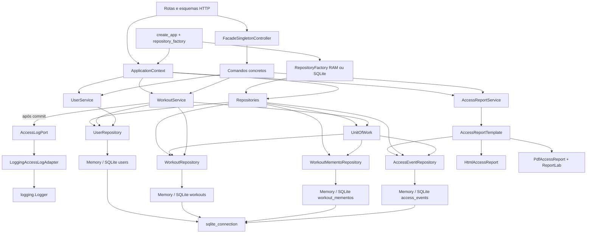
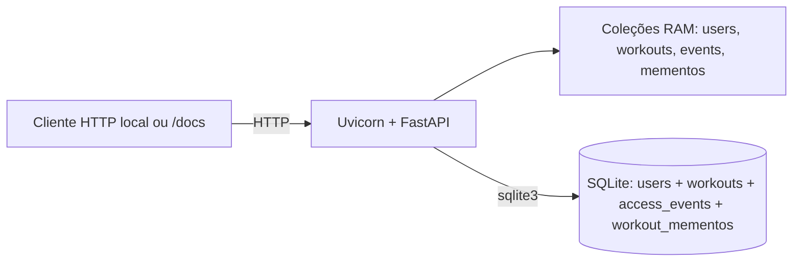
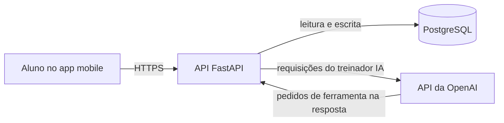

# Arquitetura do projeto

## Estado atual — Sprint 5

API local Python 3.12/FastAPI/Pydantic. Usuários, treinos, eventos de acesso,
Adapter de log, relatório HTTP em HTML/PDF, fachada baseada em Command e
desfazer da última atualização por Memento estão implementados. As changes
[relatorio-de-acessos](../openspec/changes/archive/2026-11-17-relatorio-de-acessos/proposal.md)
e [desfazer-atualizacao](../openspec/changes/archive/2026-11-25-desfazer-atualizacao/proposal.md)
definem os contratos; aplicativo mobile, PostgreSQL e
treinador IA seguem futuros. Decisões:
[ADR 0005](adr/0005-treinos-fachada.md),
[0006](adr/0006-repository-factory.md),
[0009](adr/0009-fachada-command.md),
[0010](adr/0010-persistencia-memento.md) e
[0011](adr/0011-contrato-desfazer-treino.md).

### Arquitetura lógica



Serviços consomem protocolos em `ports`; a composição escolhe implementações.
A fachada não chama serviços diretamente: cada método cria um comando imutável
e o invoca com o contexto da aplicação
([ADR 0009](adr/0009-fachada-command.md)). O comando não guarda histórico.
`WorkoutService` grava treino, Memento e evento na mesma
`unit_of_work.transaction()`. No `PUT`, o serviço substitui o único Memento
pelo estado anterior; no desfazer, consome esse Memento e restaura nome e
descrição sem passar pela operação pública de atualização, para não gerar
outro Memento nem um evento `update`
([ADR 0010](adr/0010-persistencia-memento.md),
[ADR 0011](adr/0011-contrato-desfazer-treino.md)).
O Adapter registra somente proprietário, operação e instante UTC após o
commit; falha auxiliar não altera o sucesso
([ADR 0007](adr/0007-adapter-log-eventos.md)). `GET /statistics/accesses` delega ao
Template Method: período UTC, uma leitura, agregação imutável e renderização.
HTML e PDF exibem os mesmos dados, com `undo` entre as cinco operações; falhas
retornam 503 com mensagem genérica
([ADR 0008](adr/0008-relatorio-template-method.md)).

### Arquitetura física atual



RAM e SQLite são alternativas na inicialização (`USER_STORAGE`, `USER_DATABASE`).
SQLite cria `access_events` e `workout_mementos` sem apagar tabelas legadas.
Na primeira abertura de um banco anterior à operação `undo`, a tabela de
eventos é recriada na mesma transação para ampliar o `CHECK`, copiando os
eventos existentes. Eventos e Mementos não são fabricados para o passado. RAM
perde eventos e estados anteriores ao reiniciar; arquivo compartilhado propaga
o que foi confirmado entre processos. A contagem em `/statistics/entities`
ignora eventos e Mementos.

### RNFs e decisões verificáveis

| RNF | Decisão | Evidência |
| --- | --- | --- |
| NF-SEG-01, NF-SEG-02 | Resposta pública de usuários sem credenciais; hash com salt. ADRs 0003/0004. | Testes de usuários, credenciais e hash; comparação de respostas. |
| NF-SEG-03 | Resposta de treino só com quatro campos; erros sem input/ctx. ADR 0005. | Tipos inválidos/extras sensíveis, senha usada como texto legítimo e DELETE vazio. |
| NF-CON-01, NF-CON-04 | Erros de banco preservados como causa, mensagens públicas constantes. ADRs 0003/0005. | Tabelas removidas, todas as rotas 503, busca de vínculo e contagem em cada repositório. |
| NF-CON-02, NF-CON-05 | Transações SQLite por escrita, incluindo Memento e evento `undo`. ADRs 0003/0005/0010/0011. | Gatilhos que abortam escrita; rollback de atualização e desfazer; estado integral preservado. |
| NF-CON-03, NF-CON-06 | CREATE IF NOT EXISTS e arquivo persistido; AUTOINCREMENT em treinos. ADR 0005. | Banco legado, reinício com campos/exclusão/contagem e continuação dos IDs. |
| NF-MAN-01, NF-MAN-02 | Serviços injetados por protocolos e DTOs. ADRs 0004/0005. | Contratos substitutos independentes, sem SQL/HTTP no serviço. |
| NF-USA-01, NF-USA-02 | Validação de campos e exceções específicas antes da escrita. ADRs 0004/0005. | Limites, normalização, tipos e prioridade das regras no domínio. |

As especificações normativas estão em [RNFs](../openspec/specs/rnf/); o
[projeto](08-projeto.md) detalha os participantes de Singleton, Facade, Command e Memento.

## Stack planejada

| Parte | Tecnologias | Papel |
| --- | --- | --- |
| API | Python 3.12 e FastAPI | Expor operações de usuários e treinos, validar acesso e coordenar o agente. |
| Persistência | PostgreSQL e, como ORM proposta, SQLAlchemy 2 | Guardar usuários, treinos, exercícios e histórico em uma possível evolução posterior do SQLite atual. |
| Mobile | React Native com Expo | Interface do aluno para solicitar, visualizar e acompanhar treinos. Expo Go será usado nos primeiros testes. |
| Treinador IA | API da OpenAI, chamada pela API do projeto | Consultar dados permitidos e solicitar criação ou edição de treinos por ferramentas do servidor. |

“Alguma ORM” foi interpretado como uma escolha ainda em aberto. [SQLAlchemy](https://docs.sqlalchemy.org/en/20/orm/) é a proposta inicial; a decisão final e as migrações de banco devem ser registradas quando a persistência for implementada. [Expo Go](https://docs.expo.dev/develop/development-builds/faq/) é adequado para prototipar, mas um *development build* será necessário se o app usar bibliotecas nativas que não vêm nele.

## Comunicação entre as partes



O app mobile conversa com a API do projeto. A API é responsável por acessar o PostgreSQL e por executar as ferramentas solicitadas pelo agente. A OpenAI devolve pedidos de ferramenta ao backend; o backend valida os argumentos e executa a operação, sem dar acesso direto ao banco ao modelo. O agente representa o treinador, não um usuário cadastrado como aluno ou administrador. A chave da OpenAI ficará no ambiente do servidor, não no aplicativo mobile. A [documentação oficial da OpenAI](https://developers.openai.com/api/docs/guides/function-calling) descreve o fluxo de chamadas de ferramentas; suas [práticas de produção](https://developers.openai.com/api/docs/guides/production-best-practices) orientam a guardar a chave fora do código. Uma primeira opção é usar a Responses API com *function calling*; a escolha definitiva será feita quando o agente for implementado.

## Estrutura futura sugerida

Esta árvore representa a direção do projeto, não pastas que já existem:

```text
training-platform/
├── apps/
│   ├── api/
│   │   ├── app/
│   │   │   ├── main.py         # inicialização do FastAPI
│   │   │   ├── routers/        # endpoints HTTP
│   │   │   ├── users/          # cadastro e perfis
│   │   │   ├── workouts/       # planos, exercícios e acompanhamento
│   │   │   ├── agent/          # orquestração e ferramentas do treinador IA
│   │   │   └── persistence/    # conexão e modelos do banco
│   │   ├── migrations/         # evolução do esquema do PostgreSQL
│   │   ├── tests/
│   │   └── requirements.txt
│   └── mobile/
│       ├── app.json            # configuração do Expo
│       ├── src/
│       │   ├── features/       # telas e fluxos por funcionalidade
│       │   ├── components/     # componentes reutilizáveis
│       │   └── services/       # cliente da API do projeto
│       └── package.json
└── docs/
```

A API atual permanece em `app/`. Quando houver código mobile, a equipe poderá mover a API para `apps/api/` e criar `apps/mobile/` no mesmo trabalho, ajustando imports, comandos e testes. Não é preciso criar pastas vazias agora. A biblioteca de navegação, o provedor de autenticação, o driver PostgreSQL e a forma exata de orquestrar o agente serão escolhidos nas sprints em que essas partes forem implementadas.

O armazenamento atual é selecionado na inicialização, conforme o [ADR 0003](adr/0003-validacao-persistencia.md). SQLite usa transações e restrições únicas; erros de validação e persistência são tratados na fronteira HTTP. PostgreSQL permanece uma possibilidade futura.
